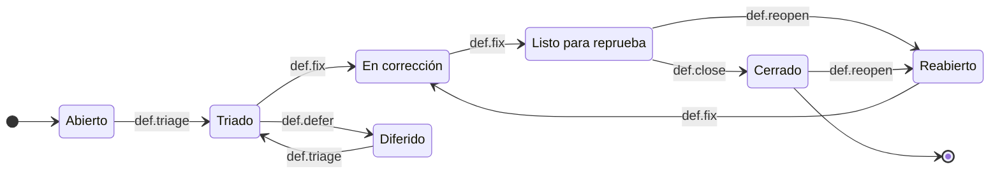
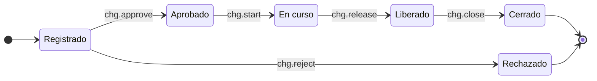
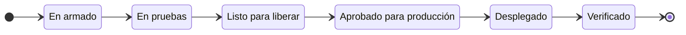

# Flujos y máquinas de estados

Los flujos son configuración: viven en las tablas de `workflow` y `qa-admin` los edita. Sus valores predeterminados están en [`src/migrations/00011_seed_workflow.sql`](../src/migrations/00011_seed_workflow.sql), que es la fuente; este documento los dibuja.

Cada transición exige un permiso, puede exigir un motivo y puede tener reglas de bloqueo. Toda transición queda en la auditoría.

## REQ (requerimiento §8.1)

```mermaid
stateDiagram-v2
    direction LR
    [*] --> Registrado
    Registrado --> RiesgoEvaluado: risk.assess
    RiesgoEvaluado --> DisenoDePruebas: req.start_design
    DisenoDePruebas --> EnDesarrollo: req.start_development
    EnDesarrollo --> EntregadoAQA: req.deliver
    EntregadoAQA --> EnPruebas: req.start_testing
    EnPruebas --> ConDefectos: req.report_defects
    ConDefectos --> EnPruebas: req.start_testing
    EnPruebas --> AprobadoQA: req.approve_qa
    AprobadoQA --> EnPaquete: req.package
    EnPaquete --> Liberado: req.release
    Liberado --> Verificado: req.verify
    Verificado --> Cerrado: req.close
    Cerrado --> [*]

    EnPruebas --> Diferido: req.defer
    ConDefectos --> Diferido: req.defer
    AprobadoQA --> Diferido: req.defer
    EnPaquete --> Diferido: req.defer
    Diferido --> EnPruebas: req.start_testing

    RiesgoEvaluado: Riesgo evaluado
    DisenoDePruebas: Diseño de pruebas
    EnDesarrollo: En desarrollo
    EntregadoAQA: Entregado a QA
    EnPruebas: En pruebas
    ConDefectos: Con defectos
    AprobadoQA: Aprobado QA
    EnPaquete: En paquete
    Verificado: Verificado post-despliegue
    Diferido: Diferido a otro paquete
```

`Rechazado` (final, `req.reject`, con motivo) se alcanza desde cualquier estado anterior a `Aprobado QA`; no se dibuja para no cruzar todo el diagrama.

| Transición | Regla de bloqueo | Ruta |
|---|---|---|
| Registrado → Riesgo evaluado | Existe un RISK (`risk_assessed`). | Todas |
| Registrado → Riesgo evaluado | El RISK indica características ISO 25010 (`risk_has_quality_characteristics`). | Alta |
| En desarrollo → Entregado a QA | Contrato de entrada completo (`entry_contract_complete`). | Todas |
| En pruebas → Aprobado QA | Cobertura mínima según el RISK (`min_coverage`). | Todas |
| En pruebas → Aprobado QA | Cero DEF de severidad alta abiertos (`no_open_defect_with_severity`). | Todas |
| En pruebas → Aprobado QA | Enlaces con instantánea (`links_have_snapshot`). **Solo avisa.** | Todas |

Diferir un REQ exige motivo y el permiso `req.defer`, que tiene `change-manager`: así queda registrado quién aceptó y por qué.

## DEF (requerimiento §8.3)

| Transición | Regla de bloqueo |
|---|---|
| Triado → Diferido | La severidad no es alta (`defect_severity_is_not`). Exige motivo y `def.defer` (`change-manager`). |

Reabrir exige motivo. El tiempo en cada estado se calcula al leer; no hay SLA.

## CHG `[SUPUESTO]`

El requerimiento pide la máquina de estados del CHG pero no define sus estados (solo sus rutas, §8.2). Esta es una propuesta mínima, por confirmar con change management (decisión D17).

### Rutas del CHG (requerimiento §8.2)

La ruta no cambia los estados: cambia qué reglas aplican (columna `route` de `blocking_rule`).

| Ruta | Sistemas | Exige | En el esquema hoy |
|---|---|---|---|
| Alta (`high`) | SIMF, SGLPAR | RISK con características ISO 25010, regresión completa por impacto + TC críticos, checklist firmado, DIAG. | La regla del RISK. El resto llega con las fases 3 y 4. |
| Ligera (`light`) | SyPago y fixes | RISK simplificado, regresión por impacto, SMOKE. | RISK sin características obligatorias. |
| Fix menor (`minor_fix`) | Cambios de bajo riesgo en módulos estables | TC mínimos definidos por QA. | El valor de ruta existe; qué TC mínimos pide está `[POR DEFINIR]`. |

## PKG (requerimiento §8.4)

Sembrado en la migración 00015 (decisión D48). El contenido del PKG (BUILD y REQ) solo cambia en «En armado».

| Transición | Permiso | Regla de bloqueo |
|---|---|---|
| En armado → En pruebas | `pkg.start_testing` | Tiene al menos un BUILD y un REQ; la regresión está confirmada. `[SUPUESTO]` |
| En pruebas → En armado | `pkg.reopen`, con motivo | Ninguna. El paso no está en el requerimiento: `[SUPUESTO]` para corregir el contenido. |
| En pruebas → Listo para liberar | `pkg.mark_ready` | Toda la regresión final con su último RUN sobre un BUILD del PKG aprobado `[SUPUESTO]`; ningún REQ del PKG con un DEF de severidad alta abierto (regla de negocio 2). |
| Listo para liberar → Aprobado para producción | `pkg.approve_production` | Ninguna. |
| Aprobado para producción → Desplegado | `pkg.deploy` | Hay un despliegue exitoso del PKG en un ambiente de producción. `[SUPUESTO]` |
| Desplegado → Verificado | `pkg.verify` | Ninguna hasta la fase 4 (DIAG y SMOKE). |

### Regresión por impacto (regla de negocio 4)

1. Cada REQ y cada TC declaran los componentes (COMP) que tocan.
2. Al **proponer**, el sistema toma los TC activos que ejercitan algún componente tocado por los REQ del PKG, más los TC críticos del sistema.
3. QA **ajusta**: incluye o excluye TC. El criterio es obligatorio cuando la decisión difiere de lo propuesto y queda con su autor y su fecha.
4. QA **confirma**: desde entonces la selección no cambia. Se conservan lo propuesto y lo final para compararlos.

## Permisos por rol (predeterminados)

| Rol | Permisos |
|---|---|
| `change-manager` | `chg.*`, `req.create`, `req.edit`, `req.release`, `req.close`, `req.reject`, `req.defer`, `def.defer`, `pkg.approve_production`, `pkg.deploy`, `dep.create_production`, `link.manage`, `doc.upload`, `comment.create`, `audit.read` |
| `qa` | `req.edit`, `risk.assess`, `req.start_design`, `req.start_testing`, `req.report_defects`, `req.approve_qa`, `req.verify`, `testdesign.manage`, `run.create`, `exp.create`, `def.create`, `def.edit`, `def.triage`, `def.close`, `def.reopen`, `comp.manage`, `pkg.start_testing`, `pkg.reopen`, `pkg.mark_ready`, `pkg.verify`, `regression.manage`, `env.manage`, `dep.create`, `link.manage`, `doc.upload`, `comment.create`, `audit.read` |
| `qa-admin` | Todo lo de `qa`, más `admin.configure` e `import.run` |
| `dev` | `req.edit`, `req.start_development`, `req.deliver`, `req.package`, `entry_contract.check`, `def.fix`, `comp.manage`, `build.register`, `pkg.build`, `link.manage`, `doc.upload`, `comment.create` |
| `ops` | `doc.upload`, `comment.create` |
| `auditor` | `audit.read` |

Leer no exige permiso: cualquier usuario con sesión y un rol ve todo, salvo la auditoría, que pide `audit.read`.

## Por definir

| Tema | Valor provisional | Quién decide |
|---|---|---|
| Cobertura mínima por nivel de riesgo | 100 % en los tres niveles | QA |
| Estados del CHG | La propuesta de arriba | Change management |
| Quién incluye un REQ en un paquete (`req.package`, y `pkg.build` en la fase 3) | `dev` | Change management y QA (pregunta 3) |
| Quién tría (`def.triage`) y con qué cadencia | `qa` | Change management y QA (pregunta 2) |
| Desde qué estados se puede rechazar o diferir un REQ | Los del diagrama | Change management |
| TC mínimos de la ruta fix menor | Sin regla | QA |
