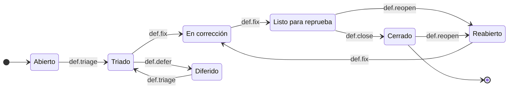
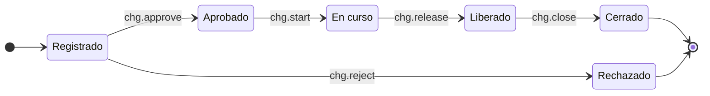
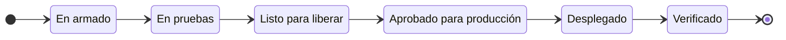

# Flujos y máquinas de estados

Los flujos son configuración: viven en las tablas de `workflow` y `qa-admin` los edita. Sus valores predeterminados están en [`src/migrations/00011_seed_workflow.sql`](../src/migrations/00011_seed_workflow.sql), que es la fuente; este documento los dibuja.

Cada transición exige un permiso, puede exigir un motivo y puede tener reglas de bloqueo. Toda transición queda en la auditoría.

## REQ (requerimiento §8.1)

```mermaid
stateDiagram-v2
    direction LR
    [*] --> Registrado
    Registrado --> RiesgoEvaluado: risk.assess
    RiesgoEvaluado --> DisenoDePruebas: req.start_design
    DisenoDePruebas --> EnDesarrollo: req.start_development
    EnDesarrollo --> EntregadoAQA: req.deliver
    EntregadoAQA --> EnPruebas: req.start_testing
    EnPruebas --> ConDefectos: req.report_defects
    ConDefectos --> EnPruebas: req.start_testing
    EnPruebas --> AprobadoQA: req.approve_qa
    AprobadoQA --> EnPaquete: req.package
    EnPaquete --> Liberado: req.release
    Liberado --> Verificado: req.verify
    Verificado --> Cerrado: req.close
    Cerrado --> [*]

    EnPruebas --> Diferido: req.defer
    ConDefectos --> Diferido: req.defer
    AprobadoQA --> Diferido: req.defer
    EnPaquete --> Diferido: req.defer
    Diferido --> EnPruebas: req.start_testing

    RiesgoEvaluado: Riesgo evaluado
    DisenoDePruebas: Diseño de pruebas
    EnDesarrollo: En desarrollo
    EntregadoAQA: Entregado a QA
    EnPruebas: En pruebas
    ConDefectos: Con defectos
    AprobadoQA: Aprobado QA
    EnPaquete: En paquete
    Verificado: Verificado post-despliegue
    Diferido: Diferido a otro paquete
```

`Rechazado` (final, `req.reject`, con motivo) se alcanza desde cualquier estado anterior a `Aprobado QA`; no se dibuja para no cruzar todo el diagrama.

| Transición | Regla de bloqueo | Ruta |
|---|---|---|
| Registrado → Riesgo evaluado | Existe un RISK (`risk_assessed`). | Todas |
| Registrado → Riesgo evaluado | El RISK indica características ISO 25010 (`risk_has_quality_characteristics`). | Alta |
| En desarrollo → Entregado a QA | Contrato de entrada completo (`entry_contract_complete`). | Todas |
| En pruebas → Aprobado QA | Cobertura mínima según el RISK (`min_coverage`). | Todas |
| En pruebas → Aprobado QA | Cero DEF de severidad alta abiertos (`no_open_defect_with_severity`). | Todas |
| En pruebas → Aprobado QA | Enlaces con instantánea (`links_have_snapshot`). **Solo avisa.** | Todas |

Diferir un REQ exige motivo y el permiso `req.defer`, que tiene `change-manager`: así queda registrado quién aceptó y por qué.

## DEF (requerimiento §8.3)

| Transición | Regla de bloqueo |
|---|---|
| Triado → Diferido | La severidad no es alta (`defect_severity_is_not`). Exige motivo y `def.defer` (`change-manager`). |

Reabrir exige motivo. El tiempo en cada estado se calcula al leer; no hay SLA.

## CHG `[SUPUESTO]`

El requerimiento pide la máquina de estados del CHG pero no define sus estados (solo sus rutas, §8.2). Esta es una propuesta mínima, por confirmar con change management (decisión D17).

### Rutas del CHG (requerimiento §8.2)

La ruta no cambia los estados: cambia qué reglas aplican (columna `route` de `blocking_rule`).

| Ruta | Sistemas | Exige | En el esquema hoy |
|---|---|---|---|
| Alta (`high`) | SIMF, SGLPAR | RISK con características ISO 25010, regresión completa por impacto + TC críticos, checklist firmado, DIAG. | La regla del RISK; en el PKG, `checklist_signed` y `diagnostic_reviewed`. |
| Ligera (`light`) | SyPago y fixes | RISK simplificado, regresión por impacto, SMOKE. | RISK sin características obligatorias; en el PKG, `smoke_passed`. |
| Fix menor (`minor_fix`) | Cambios de bajo riesgo en módulos estables | TC mínimos definidos por QA. | El valor de ruta existe; qué TC mínimos pide está `[POR DEFINIR]`. En el PKG no exige checklist, DIAG ni SMOKE `[SUPUESTO]`. |

**La ruta de un PKG** es la más exigente de las de sus REQ (alta, luego ligera, luego fix menor). La de un REQ es la de su CHG o, sin CHG, la ruta por omisión de su sistema. Un PKG sin REQ toma la de su sistema. `[SUPUESTO]`, decisión D50.

## PKG (requerimiento §8.4)

Sembrado en la migración 00015 (decisión D48). El contenido del PKG (BUILD y REQ) solo cambia en «En armado».

| Transición | Permiso | Regla de bloqueo |
|---|---|---|
| En armado → En pruebas | `pkg.start_testing` | Tiene al menos un BUILD y un REQ; la regresión está confirmada. `[SUPUESTO]` |
| En pruebas → En armado | `pkg.reopen`, con motivo | Ninguna. El paso no está en el requerimiento: `[SUPUESTO]` para corregir el contenido. |
| En pruebas → Listo para liberar | `pkg.mark_ready` | Toda la regresión final con su último RUN sobre un BUILD del PKG aprobado `[SUPUESTO]`; ningún REQ del PKG con un DEF de severidad alta abierto (regla de negocio 2). |
| Listo para liberar → Aprobado para producción | `pkg.approve_production` | Ninguna. |
| Aprobado para producción → Desplegado | `pkg.deploy` | Hay un despliegue exitoso del PKG en un ambiente de producción. `[SUPUESTO]` En ruta alta, además, el último CHK del PKG tiene todos sus pasos firmados (`checklist_signed`). |
| Desplegado → Verificado | `pkg.verify` | En ruta alta, el último DIAG del PKG está revisado y conforme (`diagnostic_reviewed`). En ruta ligera, el último SMOKE está aprobado (`smoke_passed`). `[SUPUESTO]` |

### Regresión por impacto (regla de negocio 4)

1. Cada REQ y cada TC declaran los componentes (COMP) que tocan.
2. Al **proponer**, el sistema toma los TC activos que ejercitan algún componente tocado por los REQ del PKG, más los TC críticos del sistema.
3. QA **ajusta**: incluye o excluye TC. El criterio es obligatorio cuando la decisión difiere de lo propuesto y queda con su autor y su fecha.
4. QA **confirma**: desde entonces la selección no cambia. Se conservan lo propuesto y lo final para compararlos.

### Producción: checklist, DIAG y SMOKE (fase 4, decisión D50)

Ninguno tiene estados: se registran, y cuenta lo último de cada uno.

1. **Plantilla.** Change management publica la plantilla del checklist de cada sistema. No se edita: se publica otra versión.
2. **Checklist (CHK).** Con el PKG aprobado, change management abre el CHK en un ambiente de producción del sistema; toma la última versión de la plantilla. Change management y ops firman los pasos, uno a uno y en cualquier orden. La firma no se quita. La evidencia se adjunta como documento del CHK.
3. **Despliegue.** Change management registra el despliegue del PKG en producción y pasa el PKG a «Desplegado».
4. **DIAG** (ruta alta). Dev u ops entregan el diagnóstico de ese despliegue; QA lo revisa una vez: conforme o no conforme. Si no está conforme, se entrega otro DIAG.
5. **SMOKE** (ruta ligera). QA registra la prueba de humo: aprobada o fallida. Si falló, se registra otra.
6. QA pasa el PKG a «Verificado».

### Informe de conformidad (fase 4)

QA emite el RPT de un PKG cuando lo necesita, en cualquier estado. Emitir congela la evidencia de ese momento; emitir otra vez crea la versión siguiente, que reemplaza a la anterior sin borrarla.

### Calendario (fase 4)

Junta las ventanas de los CHG vigentes y los hitos. Una **alerta de atraso** es un hito pendiente con la fecha vencida, o una ventana que terminó sin que el CHG esté «Liberado». Se ven en Inicio y en Calendario; no hay correo.

### Métricas (fase 5, decisión D52)

Solo miden: no hay metas ni SLA, y ninguna cambia un estado. Leerlas no exige permiso. Los períodos son días en UTC y, sin período, cubren los últimos 12 meses calendario con el actual.

- **Cobertura por REQ.** TC requeridos: los TC no retirados enlazados al REQ por sus UC. Aprobados: los que tienen su último RUN aprobado. El mínimo es el de la regla `min_coverage` activa para el riesgo del REQ (100 % si no dice otro). Resultado: *bajo el mínimo*, *sin TC*, *sin riesgo* (no hay RISK, no es 0 %) o *cumple*. Sin período: es la cobertura de hoy.
- **Tiempo en estado.** Para cada DEF creado en el período, los tramos entre su creación, cada transición y hoy. Por estado: DEF que pasaron, entradas (volver a un estado suma otra), mediana y percentil 90 en días naturales del tiempo total de cada DEF en el estado. De abierto a resuelto: de la creación a la última transición, para los DEF que hoy están en un estado final.
- **Tamaño de regresión.** Por PKG con la regresión confirmada en el período: TC propuestos, finales, agregados y quitados por QA, finales por origen, y finales con su último RUN sobre un BUILD del PKG aprobado.
- **Defecto escapado** `[SUPUESTO]`. Un DEF escapó si se creó después del primer despliegue exitoso, en un ambiente de producción, de un PKG que contiene su REQ. Se calcula; nadie lo marca. Tasa: escapados / DEF creados en el período.

### Planificación (fase 6, decisión D54)

Una **actividad** (ACT) ocupa a cero o más operadores de un día a otro, los dos incluidos (días UTC). Su clase es certificación, regresión, pase a producción u otra; la certificación es siempre de un CHG. Su estado sale de las fechas: *planificada*, *en curso* o *terminada*; *cancelada* es la única marca y se revierte. Nada se borra.

- **Solape:** el mismo operador en dos actividades no canceladas que comparten al menos un día. No impide guardar: se avisa en la respuesta, en la ficha, en la planificación y en Inicio.
- **Período de certificación de un CHG:** sus actividades de certificación no canceladas. Puede haber varias rondas.
- **Regla `certification_planned`** `[SUPUESTO]`, en *Entregado a QA → En pruebas* del REQ, en «solo avisa»: el CHG del REQ tiene una certificación no cancelada, con operadores, que cubre hoy. Si no, el aviso dice qué falta: el período, los operadores, o que hoy está fuera de él. Un REQ sin CHG la cumple.

## Permisos por rol (predeterminados)

| Rol | Permisos |
|---|---|
| `change-manager` | `chg.*`, `req.create`, `req.edit`, `req.release`, `req.close`, `req.reject`, `req.defer`, `def.defer`, `pkg.approve_production`, `pkg.deploy`, `dep.create_production`, `chk.manage_template`, `chk.start`, `chk.sign`, `milestone.manage`, `activity.manage`, `link.manage`, `doc.upload`, `comment.create`, `audit.read` |
| `qa` | `req.edit`, `risk.assess`, `req.start_design`, `req.start_testing`, `req.report_defects`, `req.approve_qa`, `req.verify`, `testdesign.manage`, `run.create`, `exp.create`, `def.create`, `def.edit`, `def.triage`, `def.close`, `def.reopen`, `comp.manage`, `pkg.start_testing`, `pkg.reopen`, `pkg.mark_ready`, `pkg.verify`, `regression.manage`, `env.manage`, `dep.create`, `diag.review`, `smoke.create`, `rpt.issue`, `link.manage`, `doc.upload`, `comment.create`, `audit.read` |
| `qa-admin` | Todo lo de `qa`, más `admin.configure`, `import.run` y `activity.manage` |
| `dev` | `req.edit`, `req.start_development`, `req.deliver`, `req.package`, `entry_contract.check`, `def.fix`, `comp.manage`, `build.register`, `pkg.build`, `diag.submit`, `link.manage`, `doc.upload`, `comment.create` |
| `ops` | `chk.sign`, `diag.submit`, `doc.upload`, `comment.create` |
| `auditor` | `audit.read` |

Leer no exige permiso: cualquier usuario con sesión y un rol ve todo, salvo la auditoría, que pide `audit.read`.

## Por definir

| Tema | Valor provisional | Quién decide |
|---|---|---|
| Cobertura mínima por nivel de riesgo | 100 % en los tres niveles | QA |
| Estados del CHG | La propuesta de arriba | Change management |
| Quién incluye un REQ en un paquete (`req.package`, y `pkg.build` en la fase 3) | `dev` | Change management y QA (pregunta 3) |
| Quién tría (`def.triage`) y con qué cadencia | `qa` | Change management y QA (pregunta 2) |
| Desde qué estados se puede rechazar o diferir un REQ | Los del diagrama | Change management |
| TC mínimos de la ruta fix menor | Sin regla | QA |
| Plantilla del checklist y quién firma cada paso | Una por sistema; firma cualquiera con `chk.sign` | Change management (preguntas 1 y 2 de la fase 4) |
| De qué se emite el informe | Del PKG | Change management y QA (pregunta 4 de la fase 4) |
