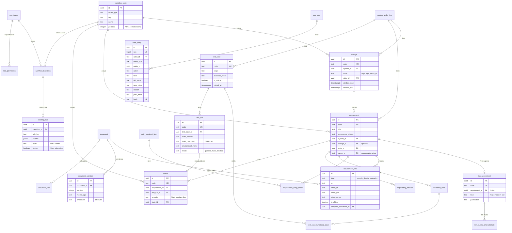
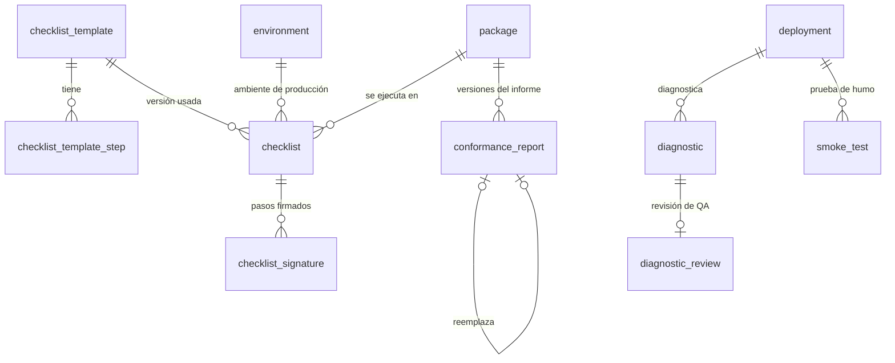
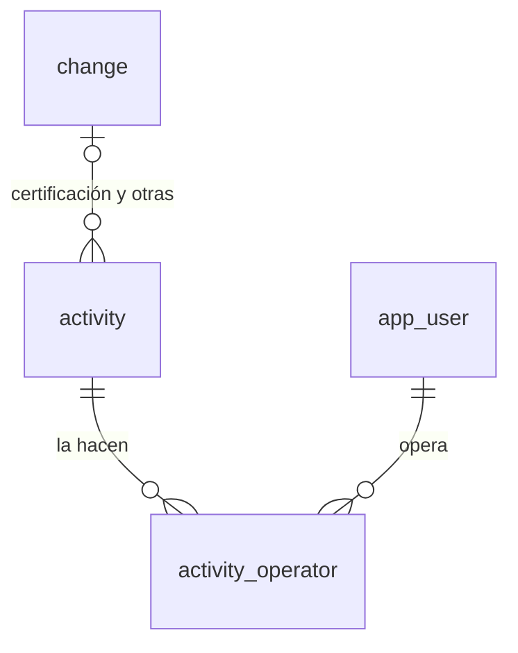

# Modelo de datos

La fuente única del esquema son las migraciones de [`src/migrations/`](../src/migrations). Este documento las explica; si difieren, mandan las migraciones.

El esquema cubre lo que construye la fase 2 (MVP). Las entidades de las fases 3 y 4 aparecen al final como previstas y no tienen tablas todavía (reglas §A.1.1: solo lo que pide la fase).

## Convenciones

- Una base, un esquema (`kaoru`). Tablas en singular y snake_case.
- Llave técnica `uuid` (UUIDv7, generada por la aplicación). La excepción es `app_user.id`, que es el `sub` de Keycloak.
- Cada entidad con ID legible tiene además `code` único e inmutable (`REQ-2026-0042`), que sale de `code_sequence` (prefijo + año).
- Valores fijos como `text` con `CHECK`, en inglés. Los estados no son `CHECK`: son filas de `workflow_state`.
- `timestamptz` en UTC. Las tablas inmutables solo llevan `created_at`.
- Lo que tiene historia no se borra: llaves foráneas con `ON DELETE RESTRICT`.

## Roles de base de datos

| Rol | Uso | Puede |
|---|---|---|
| `kaoru_owner` | Aplica las migraciones al arrancar. | Todo dentro del esquema `kaoru`. |
| `kaoru_app` | Conexión de ejecución de `kaoru-api`. | `SELECT`, `INSERT`, `UPDATE`, `DELETE` sobre las tablas, salvo las inmutables. No cambia el esquema. |

Tablas de solo inserción para `kaoru_app` (sin `UPDATE` ni `DELETE`): `audit_entry`, `test_run`, `document_version` y `comment`. Lo comprueba [`tools/check-migrations.sh`](../tools/check-migrations.sh).

Los crea [`infra/postgres/init.sql`](../infra/postgres/init.sql).

## Diagrama (fase 2)

`document_link` y `comment` apuntan a cualquier entidad con `entity_type` + `entity_id`, sin llave foránea; el caso de uso comprueba que la entidad existe.

## Tablas por feature

| Feature | Tablas | Migración |
|---|---|---|
| `user` | `app_user` | 00001 |
| (compartido) | `system_under_test`, `code_sequence` | 00001 |
| `workflow` | `workflow_state`, `workflow_transition`, `permission`, `role_permission`, `blocking_rule` | 00002, 00011 |
| `audit` | `audit_entry` | 00003 |
| `change` | `change` | 00004 |
| `document` | `document`, `document_version`, `document_link` | 00005 |
| `requirement` | `requirement`, `requirement_link`, `entry_contract_item`, `requirement_entry_check` | 00006 |
| `comment` (propuesto, D23) | `comment` | 00006 |
| `risk` | `risk_assessment`, `risk_quality_characteristic` | 00007 |
| `testdesign` | `functional_case`, `test_case`, `test_case_functional_case` | 00008 |
| `execution` | `test_run`, `exploratory_session` | 00009 |
| `defect` | `defect` | 00010 |
| `traceability` | Ninguna: solo lee. | — |
| Fases 3, 4 y 6 | Ver las secciones de abajo. | 00014 a 00018 |

## Cómo responde el modelo a las preguntas del producto

- **Matriz (regla de negocio 1):** `requirement` → `risk_assessment` → `functional_case` → `test_case_functional_case` → `test_case` → último `test_run` → `defect`. Es una sola consulta de `traceability`.
- **Tiempo en cada estado:** se calcula al leer, con las filas de `audit_entry` donde `action = 'transition'`. No hay una tabla aparte de historial de estados.
- **Cobertura:** TC del REQ cuyo último RUN es `passed` sobre el total de TC activos del REQ.
- **Qué falta para avanzar:** las `blocking_rule` de las transiciones que salen del estado actual, evaluadas por el dominio.
- **Cadena de auditoría:** `hash = SHA-256(prev_hash + contenido de la fila)`. El orden lo da `seq`. La inserción se serializa con un bloqueo para que dos escrituras no lean el mismo `prev_hash`.

## Fase 3 (migraciones 00014 y 00015, decisión D48)

| Tabla | Dueño | Qué guarda |
|---|---|---|
| `component` | `component` | COMP: componente del catálogo de un sistema. Se retira, no se borra. |
| `requirement_component`, `test_case_component` | `requirement`, `testdesign` | Impacto: qué componentes toca un REQ y cuáles ejercita un TC. |
| `build`, `build_requirement` | `build` | BUILD inmutable (solo inserción): versión, checksum único y manifiesto. |
| `environment` | `environment` | ENV: ambiente de un sistema, con tipo y sistema operativo. Lo instalado sale de su último despliegue exitoso. |
| `deployment` | `environment` | DEP (solo inserción): despliegue de un BUILD o de un PKG en un ambiente. |
| `package`, `package_build`, `package_requirement` | `bundle` | PKG con su estado, sus BUILD y sus REQ. |
| `regression_selection`, `regression_item` | `regression` | Regresión de un PKG: lo propuesto, lo final y el criterio de cada ajuste. |

`test_run` y `exploratory_session` ganan `build_id` y `environment_id`. La versión, el checksum y el nombre del ambiente se siguen copiando en la fila como evidencia; las filas anteriores quedan sin BUILD ni ENV.

## Fase 4 (migraciones 00016 y 00017, decisión D50)

| Tabla | Dueño | Qué guarda |
|---|---|---|
| `checklist_template`, `checklist_template_step` | `production` | Plantilla del checklist de un sistema, versionada (solo inserción): publicar crea la versión siguiente. |
| `checklist` | `production` | CHK (solo inserción): la ejecución de una versión de la plantilla para un PKG en un ambiente de producción. |
| `checklist_signature` | `production` | La firma de un paso (solo inserción): quién, cuándo y con qué comentario. Un paso se firma una vez. |
| `diagnostic` | `production` | DIAG (solo inserción): notas de dev u ops sobre un despliegue del PKG en producción. |
| `diagnostic_review` | `production` | La revisión de QA de un DIAG (solo inserción, una por DIAG): conforme o no conforme. |
| `smoke_test` | `production` | SMOKE (solo inserción): resultado de la prueba de humo sobre un despliegue del PKG en producción. |
| `conformance_report` | `report` | RPT (solo inserción): el Markdown tal como se emitió, su SHA-256 y el RPT anterior al que reemplaza. |
| `milestone` | `planning` | Hito del calendario: fecha, responsable, notas y cumplido. Se edita. |

- **Las ventanas de cambio no se copian:** siguen en `change.window_start` y `change.window_end`; el calendario las lee por un caso de uso de `change`.
- **Lo que no se guarda:** la ruta del PKG (se calcula de sus REQ), si un CHK está completo, las alertas de atraso y los días de atraso. Todo se calcula al leer.
- `blocking_rule.rule_key` admite `checklist_signed`, `diagnostic_reviewed` y `smoke_passed`; `document_link.entity_type` admite `checklist`, `diagnostic` y `smoke_test`.
- `kaoru_app` no tiene `UPDATE` ni `DELETE` sobre ninguna tabla de la fase salvo `milestone`; `tools/check-migrations.sh` lo comprueba.

## Fase 6 (migración 00018, decisión D54)

| Tabla | Dueño | Qué guarda |
|---|---|---|
| `activity` | `planning` | ACT: clase, título, CHG (obligatorio en la certificación), fechas de inicio y fin (días, las dos incluidas), notas y `cancelled_at`. Se edita; no se borra. |
| `activity_operator` | `planning` | Los operadores de una actividad (`app_user`). Editar los operadores reemplaza la lista. |

- **`CHECK`:** `end_date >= start_date`, la clase entre las cuatro y `kind <> 'certification' OR change_id IS NOT NULL`. El largo máximo de un año lo valida el dominio.
- **Índices:** `(start_date, end_date)` para la planificación de un rango, `change_id` para la certificación de un CHG y `activity_operator(user_id)` para las actividades de un operador. `make check-perf` mide la planificación con 3 000 actividades y 30 operadores.
- **Lo que no se guarda:** el estado (sale de las fechas), los solapes y si un CHG tiene su certificación lista. Todo se calcula al leer.
- `kaoru_app` tiene sobre las dos tablas los permisos por omisión (lectura y escritura, como `milestone`). La aplicación no borra actividades: las cancela; solo borra filas de `activity_operator` al reemplazar la lista. `blocking_rule.rule_key` admite `certification_planned`.

## Pendiente

- **Vistas guardadas (§7.3):** tabla `saved_view` (dueño, lista, nombre, filtros). Son personales y no se auditan; compartir sigue siendo por URL (decisión D46).
- **Importación de la hoja:** sin tablas hasta conocer su formato (pregunta 5).
- **Índices de búsqueda de texto:** no se agregan sin una medición (reglas §A.1.1). El objetivo de menos de 1 s con 10 000 REQ y 100 000 RUN se mide en la fase 2 con datos generados.
